# SAP Cloud Identity Services (IAS) as the gateway's identity provider

This guide sets up an SAP Cloud Identity Services tenant (Identity
Authentication, "IAS") as the OIDC provider of the OpenShell gateway, as an
alternative to Keycloak or any other provider. Your users then log in to the
`openshell` CLI with their IAS account, and IAS groups decide who is a platform
admin and who is a user.

**Verified** on 2026-11-10 against an IAS trial tenant, with the v0.13.0 chart
(upstream OpenShell gateway v0.1.7) and the v0.1.6 `openshell` CLI: browser
login, token validation at the gateway, the admin role, the user role, and the
refusal of a user in neither group. The screenshots are from that tenant, with
stand-ins for its name (`my-tenant`), the ids and unrelated applications and
groups.

What you need:

- an IAS tenant (a trial works) and an administrator account in it;
- the chart installed or ready to install as in
  [production-deployment.md](production-deployment.md);
- the `openshell` CLI ([install-cli.md](install-cli.md)).

Your tenant's URL is `https://<tenant>.accounts.ondemand.com` (trial tenants:
`https://<tenant>.trial-accounts.ondemand.com`). It is the OIDC issuer below.

The numbers in the steps below match the numbered markers in the screenshots.
Open the administration console at `https://<tenant>.accounts.ondemand.com/admin/`
and sign in with your administrator account.

## 1. Create the application

1. Open the menu **Applications & Resources** and pick **Applications**.
2. Click **Create**.

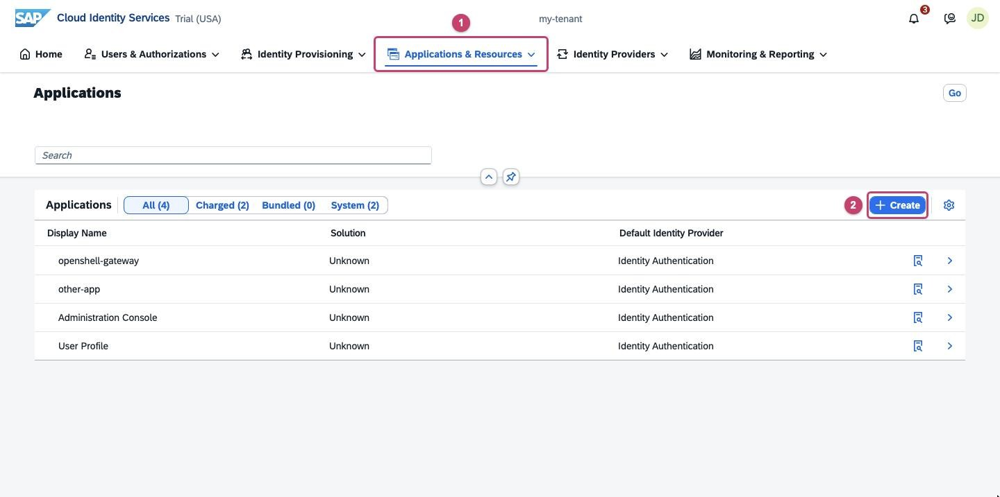

In the **Create Application** dialog:

1. **Display Name:** `openshell-gateway` (any name; only administrators see it).
2. **Protocol Type:** select **OpenID Connect**. Leave the other fields as they
   are.
3. Click **Create**.

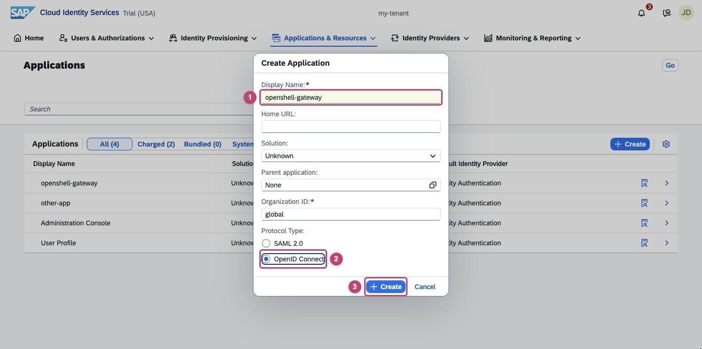

IAS opens the new application. All further settings in steps 2 to 5 are made
on this application's page.

## 2. Allow the CLI's redirect URI

1. On the application's page, stay on the **Trust** tab.
2. Click **OpenID Connect Configuration**. The first time, IAS asks for a
   configuration name: enter `openshell-gateway` (any name works) and click
   **Add**.

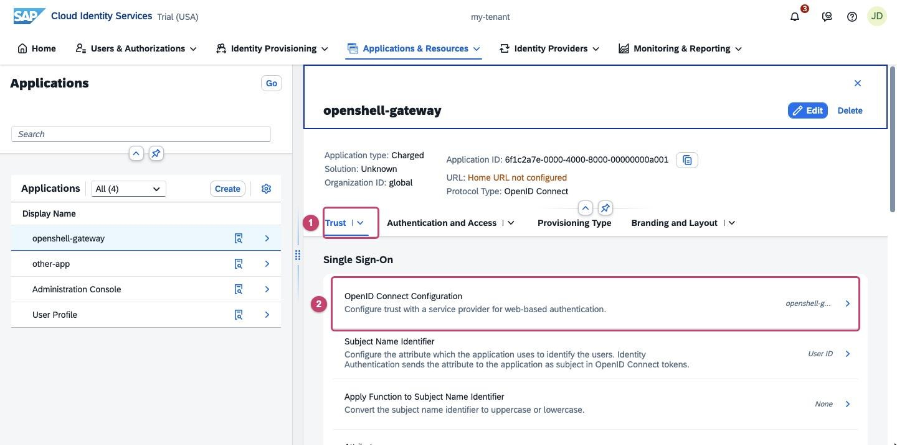

In the **OpenID Connect Configuration** panel:

1. Open the **URIs** tab.
2. Under **Redirect**, click **Add**.
3. Enter `http://127.0.0.1:*/callback` in the new row and click **Save** next
   to Add.

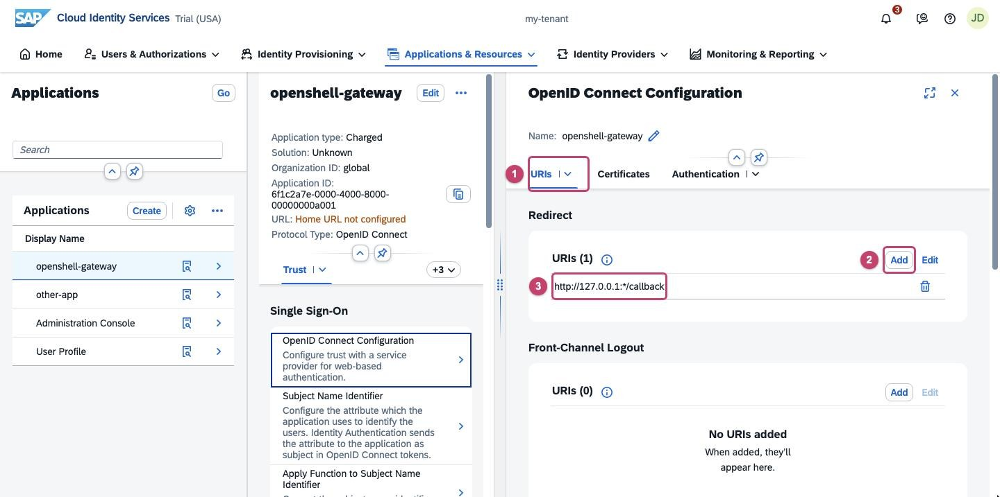

The CLI receives the login on a random loopback port, and IAS accepts the `*`
in place of the port. If your policy forbids a wildcard, register a fixed port
instead (`http://127.0.0.1:8765/callback`) and set
`OPENSHELL_CALLBACK_PORT=8765` wherever users run `openshell gateway add` and
`openshell gateway login`.

## 3. Grant types and token format

Still in the **OpenID Connect Configuration** panel:

1. Open the **Authentication** tab.
2. Under **Grant Types**, click **Edit**.
3. Keep **Authorization Code** checked.
4. Check **Enforce PKCE (S256)**.
5. Keep **Refresh** checked.

   Clear **Password**, **Client Credentials** and **JWT Bearer**: the CLI uses
   none of them. Click **Save**.

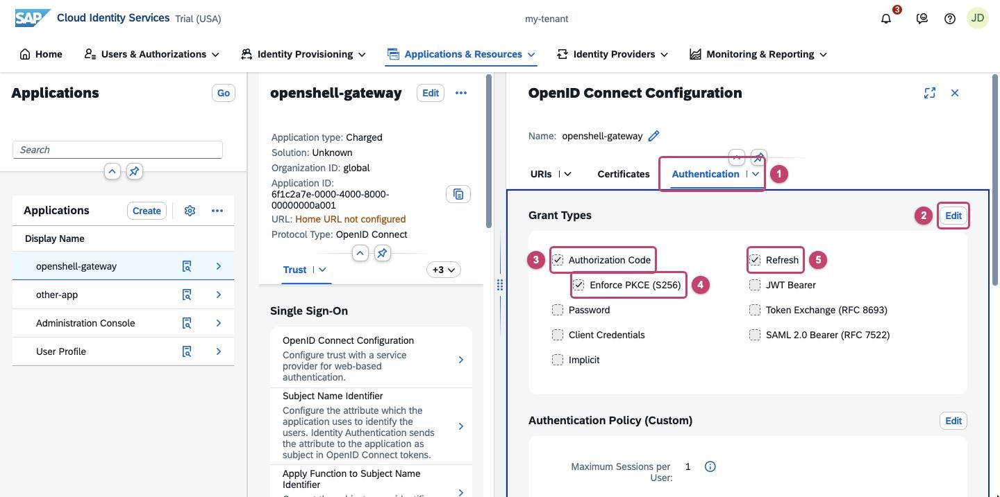

Scroll down to **Authentication Policy**:

1. Click **Edit**.
2. Under **Advanced Settings**, set **Access Token Format** to
   **JSON Web Token** and click **Save**.

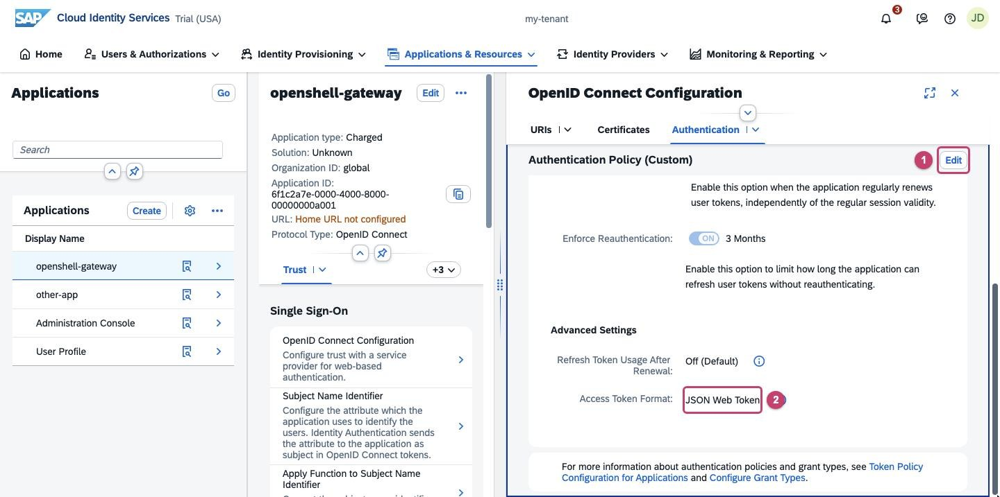

The gateway validates the access token's signature, issuer and audience itself,
so the token must be a JWT. The default, "Grant-Type Dependent", leaves that
choice to IAS.

IAS has no device-authorization endpoint, so the CLI's headless login
(`OPENSHELL_NO_BROWSER=1`) does not work with IAS. Users need a browser on the
machine where they run `openshell`.

## 4. Put the user's groups into the token

1. Back on the application's **Trust** tab, click **Attributes**.
2. Click **Add**. A new, empty row appears at the top of the list.
3. **Name:** `groups`.
4. **Source:** **Identity Directory**.
5. **Value:** **All Groups**.

Click **Save** at the top of the panel. Every token now carries the user's IAS
group names in the claim `groups`.

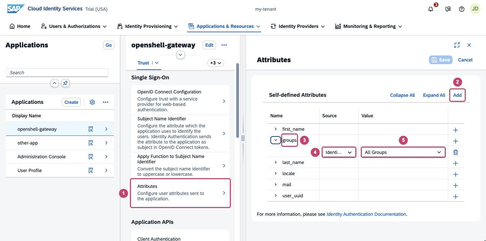

"All Groups" sends every group the user belongs to, including groups for other
applications. To send only some, create the two groups of step 6 as
application-specific groups of `openshell-gateway` (step 2 of the Create Group
wizard) and pick **Application Groups** as the value instead. That variant was
not part of the verified setup.

## 5. Note the client ID and make the application a public client

1. On the application's page, scroll down to **Application APIs** and click
   **Client Authentication**.
2. Copy the **Client ID**: it is the chart's `clientId` and `audience`
   (step 7) and the CLI's `--oidc-client-id` (step 8).

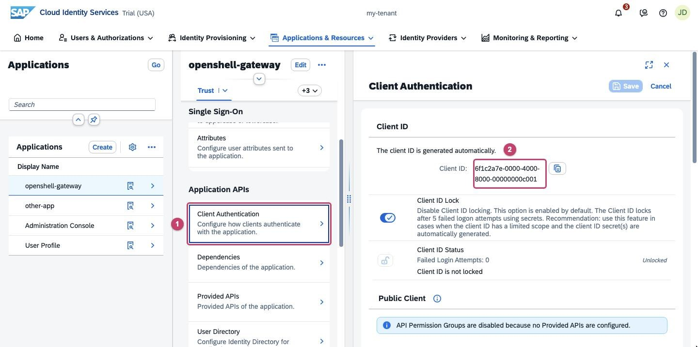

Further down in the same panel, under **Public Client**:

1. Switch on **Enable Public Client Flows**.
2. Click **Save**.

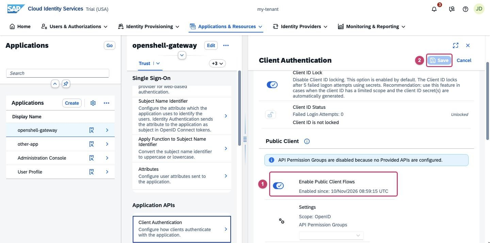

A public client logs in without a client secret, as the CLI does; PKCE (step 3)
protects the exchange instead. Do not create a secret for this application.

## 6. Create the two groups and assign people

1. Open the menu **Users & Authorizations** and pick **Groups**.
2. Click **Create**.

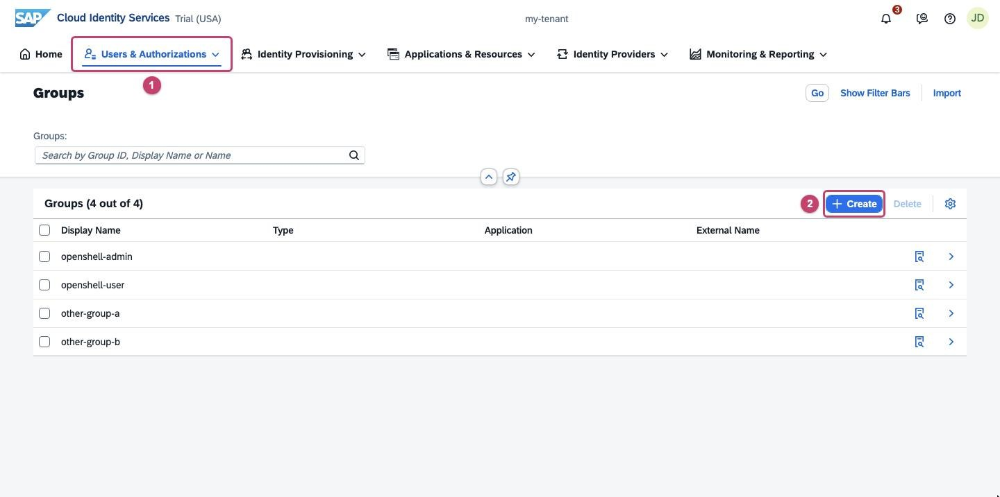

In the **Create Group** wizard:

1. **Name:** `openshell-admin`.
2. **Display Name:** `openshell-admin`. A description is optional.
3. Click **Next Step**, skip the optional **Application** step with **Next
   Step** again, and click **Finish** on the summary.

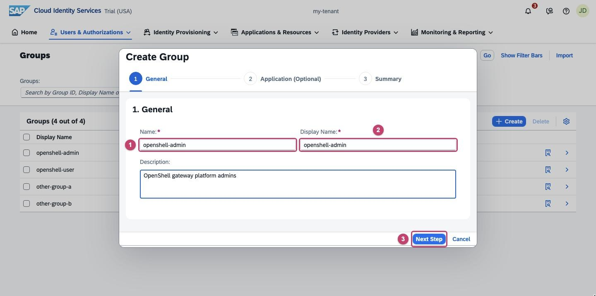

Repeat for `openshell-user`. The two groups grant:

| Group | Grants |
|-------|--------|
| `openshell-admin` | platform admin of the gateway |
| `openshell-user` | user of the gateway (workspace membership still required, see step 8) |

These are upstream's default role names, so the chart only needs to be told
where the roles are (`rolesClaim: groups`). With other names, set them in
`adminRole` and `userRole`.

Then add the members:

1. In the groups list, select the group.
2. Under **User Members**, click **Add**, select the people and confirm with
   **Add**.
3. They appear in the list.

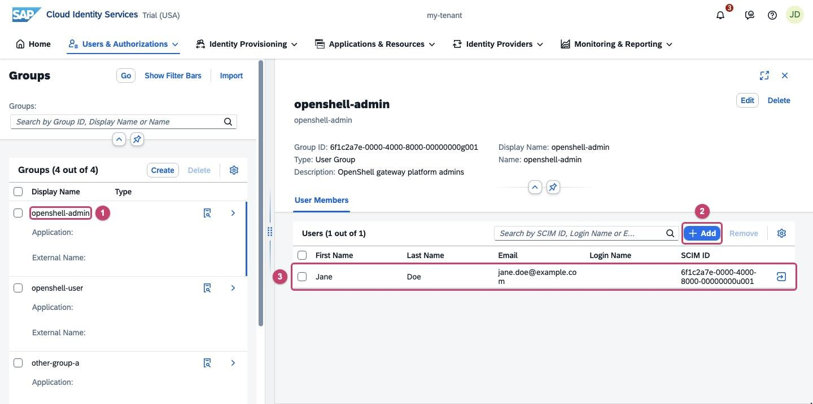

Put at least one person, yourself, in `openshell-admin`.

## 7. Point the chart at IAS

In your values overlay (never commit it):

```yaml
gateway:
  oidc:
    issuer: "https://<tenant>.accounts.ondemand.com"
    audience: "<client id>"
    clientId: "<client id>"
    rolesClaim: groups
    adminRole: openshell-admin
    userRole: openshell-user
```

The issuer has no trailing slash and no path. The gateway fetches the tenant's
discovery document and signing keys at startup over the internet; its log shows

```text
OIDC JWKS URI discovered jwks_uri=https://<tenant>.accounts.ondemand.com/oauth2/certs
JWKS keys loaded count=1
OIDC JWT validation enabled (issuer: https://<tenant>.accounts.ondemand.com)
```

The upstream gateway accepts **one** issuer. Switching an existing gateway from
another provider to IAS invalidates every existing CLI login (tokens from the
old issuer are refused), and workspace memberships granted to the old
provider's subjects no longer match anyone: grant them again for the IAS
subjects (step 8).

## 8. Log in and grant workspaces

Register the gateway with the CLI; a browser opens for the IAS login:

```bash
openshell gateway add https://openshell.<cluster-domain> --name kyma \
  --oidc-issuer https://<tenant>.accounts.ondemand.com \
  --oidc-client-id <client id>
```

(`--oidc-audience` defaults to the client id, which is what IAS puts in `aud`.)
`openshell gateway login kyma` renews the login later.

A member of `openshell-admin` can now do everything. A member of
`openshell-user` passes the role check but, like with any provider, must be
added to a workspace before they can use it. Until then the gateway answers:

```text
not a member of workspace 'default'; ask a platform admin to run:
openshell workspace member add --workspace 'default' --subject '<subject>' --role user
```

The subject is the token's `sub`: by default the IAS **User ID**, `P` followed
by digits. To look it up:

1. Open the menu **Users & Authorizations** and pick **User Management**.
2. Select the user.
3. The **User ID** is under **Personal Information**.

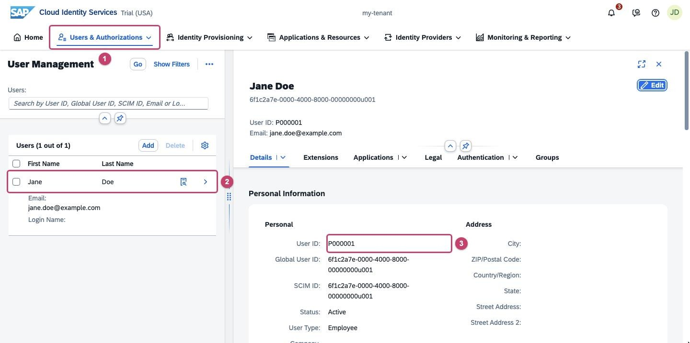

An admin runs the command from the message with that id. Workspace roles cannot
follow an IdP group: upstream closed that request
([NVIDIA/OpenShell#4286](https://github.com/NVIDIA/OpenShell/issues/4286)) as
not planned.

What the three cases look like:

| The user's groups | Result |
|-------------------|--------|
| `openshell-admin` | everything |
| `openshell-user` (and a workspace member) | sandboxes in that workspace; admin actions refused |
| neither | every call refused: `role 'openshell-user' required` |

Group changes reach the gateway with the next token: run
`openshell gateway login <name>` after changing someone's groups.

## The chart's inference provider hook

`inferenceProvider.enabled` with `gateway.oidc.clientCredentialsSecret` lets a
post-install Job register the provider with a client-credentials token. With
IAS, that token belongs to no user, so it carries no `groups` claim, and the
gateway would not give it the admin role it needs (not tested). Leave the hook
disabled and register the provider from an admin's CLI session
([production-deployment.md, step 3b](production-deployment.md#3b-register-the-inference-provider)).

## Troubleshooting

| Symptom | Cause |
|---------|-------|
| IAS error page: "The client_id sent by the client application must match the configuration…" | The client id is wrong, or the redirect URI is not registered (step 2). |
| `role 'openshell-user' required` | The user is in neither group, the `groups` attribute is missing (step 4), or the token predates a group change (log in again). |
| `not a member of workspace` | Expected for `openshell-user`: grant the workspace (step 8). |
| Gateway log: `OIDC discovery request failed` | The gateway cannot reach the tenant, or the issuer URL has a typo or a trailing slash. |
| Headless login hangs or fails | IAS has no device grant; log in where a browser is available (step 3). |
